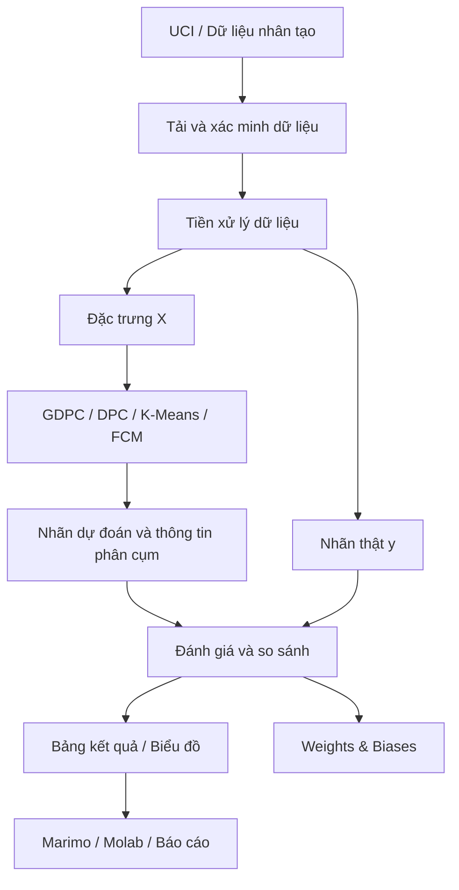
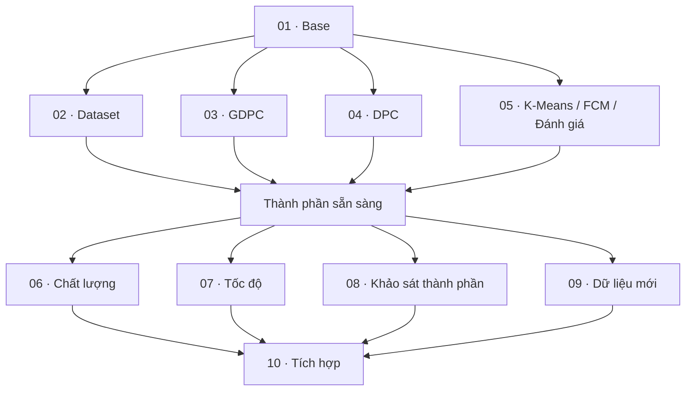

# GDPC — Tái hiện thuật toán phân cụm đỉnh mật độ

> **Môn học:** Khai thác dữ liệu · Đồ án Phân cụm và ứng dụng  
> **Lớp:** 24KHMT1 · **Nhóm:** [Điền mã nhóm]  
> **Phạm vi:** Tái hiện cốt lõi (Core Reproduction)  
> **Trạng thái:** Lập kế hoạch và chuẩn bị triển khai; chưa có kết quả thực nghiệm được xác nhận.

## 1. Giới thiệu

Dự án nghiên cứu và tự cài đặt GDPC, phương pháp phân cụm đỉnh mật độ được đề xuất trong bài báo *A Fast Density Peak Clustering Method with Autoselect Cluster Centers* (2022). GDPC cải tiến DPC bằng cách gom dữ liệu thành các nhóm nhỏ, xác định nhóm lõi và nhóm biên, sau đó kết nối các nhóm lõi để tự động lựa chọn tâm cụm và giảm chi phí tính toán.

- **Bài báo:** Zhihe Wang, Yongbiao Li, Hui Du và Xiaofen Wei, *Mobile Information Systems*, 2022, Article ID 4176101.
- **DOI:** https://doi.org/10.1155/2022/4176101
- **PDF trong dự án:** [paper/paper.pdf](paper/paper.pdf) (sẽ bổ sung).
- **Kho mã nguồn được tác giả dẫn trong bài báo:** https://github.com/yongbiaoLi/GDPC (hiện chưa xác nhận tải được mã nguồn).
- **Phạm vi thực hiện:** tái hiện đầy đủ hai thực nghiệm cốt lõi đã chọn (Bảng 6 và Hình 9), một thực nghiệm khảo sát thành phần kỹ thuật và một thực nghiệm trên tập dữ liệu mới.

## 2. Thành viên và phân công

Điền tên, MSSV, nhiệm vụ và mức đóng góp thực tế trước khi nộp. Có thể thêm hoặc bớt dòng theo số thành viên của nhóm.

| Họ và tên | MSSV | Nhiệm vụ phụ trách | Đóng góp (%) |
| --- | --- | --- | --- |
| [Thành viên] | [MSSV] | [Mã TASK] | — |
| [Thành viên] | [MSSV] | [Mã TASK] | — |
| [Thành viên nếu có] | [MSSV] | [Mã TASK] | — |

## 3. Kiến trúc dự án

Luồng xử lý dự kiến:



Nhãn thật không được truyền vào GDPC để phân cụm hoặc lựa chọn tham số dựa trên kết quả đánh giá. Nếu thuật toán đối chứng cần biết trước số cụm, phải ghi rõ điều kiện này khi so sánh.

### Cấu trúc thư mục dự kiến

```text
GDPC-Reproduction/
├── README.md
├── Report.pdf
├── requirements.txt
├── .gitignore
├── configs/                         # Cấu hình dữ liệu, thuật toán và thực nghiệm
│   ├── datasets.json
│   └── experiments.json
├── paper/
│   └── paper.pdf                    # Bài báo gốc
├── data/
│   ├── raw/                         # Dữ liệu gốc
│   ├── processed/                   # Dữ liệu sau tiền xử lý
│   └── README.md                    # Nguồn, phiên bản và quy trình xử lý
├── src/
│   ├── __init__.py
│   ├── data.py                      # Tải và tiền xử lý dữ liệu
│   ├── gdpc.py                      # Thuật toán đề xuất
│   ├── dpc.py                       # Thuật toán tiền nhiệm
│   ├── kmeans.py                    # Thuật toán đối chứng K-Means
│   ├── fcm.py                       # Thuật toán đối chứng FCM
│   ├── metrics.py                   # Các độ đo và độ lệch tương đối
│   ├── visualization.py             # Trực quan hóa
│   ├── tracking.py                  # Theo dõi thực nghiệm trên W&B
│   └── utils.py                     # Tiện ích dùng chung
├── notebooks/
│   ├── 01_clustering_performance.py # Tái hiện Bảng 6
│   ├── 02_runtime_comparison.py     # Tái hiện Hình 9
│   ├── 03_ablation_study.py         # Khảo sát tỷ lệ xác định nhóm lõi
│   └── 04_new_dataset.py            # Thực nghiệm trên Iris
├── tests/                           # Kiểm thử thuật toán và dữ liệu
├── results/                         # Số liệu thực nghiệm và đối chiếu
└── figures/                         # Biểu đồ do nhóm tự tạo
```

Cấu trúc trên là thiết kế dự kiến, chưa khẳng định các tệp đã tồn tại. Các thuật toán cung cấp giao diện thống nhất, chẳng hạn `fit(X)` và `fit_predict(X)`, để notebook sử dụng chung các thành phần mà không sao chép mã nguồn.

## 4. Kế hoạch lập trình — 10 TASK

### TASK 01 — Base: Thiết kế kiến trúc và khởi tạo dự án

- Thiết kế cấu trúc thư mục, giao diện thuật toán, luồng xử lý dữ liệu và hợp đồng đầu vào/đầu ra giữa các thành phần.
- Khởi tạo môi trường Python từ 3.9 trở lên; chọn phiên bản thư viện tương thích và cố định trong `requirements.txt`.
- Thiết lập cấu hình thực nghiệm, giá trị khởi tạo ngẫu nhiên, hệ thống ghi nhật ký, lưu kết quả, kiểm thử và tích hợp W&B.
- Quy định cách đặt tên bằng tiếng Anh, tài liệu mô tả hàm (docstring), cách quản lý mã nguồn và cách các thành viên phát triển song song.

**Đầu ra:** Bộ khung dự án, cấu hình, môi trường và tài liệu hướng dẫn phát triển.

### TASK 02 — Dataset: Thu thập và tiền xử lý dữ liệu

Chịu trách nhiệm chuẩn bị toàn bộ dữ liệu phục vụ bốn thực nghiệm. Các thông số bên dưới được ghi theo Bảng 5 của bài báo, không mặc định là thông số thực tế của mọi tệp tải về.

#### Dữ liệu thực tế — Thực nghiệm 1

1. **Zoo:** 101 mẫu, 16 đặc trưng, 7 lớp. Dữ liệu đặc điểm động vật. `dc = 0.718`.
   - Nguồn: https://archive.ics.uci.edu/dataset/111/zoo
2. **Thyroid (New Thyroid):** 215 mẫu, 5 đặc trưng, 3 lớp. Dữ liệu chức năng tuyến giáp. `dc = 0.045`.
   - Nguồn: https://archive.ics.uci.edu/dataset/102/thyroid+disease
3. **Ecoli:** 336 mẫu, 8 đặc trưng, 8 lớp theo bài báo. Dữ liệu vị trí protein. `dc = 0.093`.
   - Nguồn: https://archive.ics.uci.edu/dataset/39/ecoli
4. **Machine:** 209 mẫu, 7 đặc trưng, 8 lớp theo bài báo. Dữ liệu hiệu năng phần cứng. `dc = 0.106`.
   - Nguồn: https://archive.ics.uci.edu/dataset/29/computer+hardware
5. **Hayes-Roth:** 132 mẫu, 4 đặc trưng, 3 lớp. `dc = 0.166`.
   - Nguồn: https://archive.ics.uci.edu/dataset/44/hayes+roth
6. **Sobar-72:** 72 mẫu, 19 đặc trưng, 2 lớp. Dữ liệu hành vi liên quan nguy cơ ung thư cổ tử cung. `dc = 0.629`.
   - Nguồn: https://archive.ics.uci.edu/dataset/537/cervical+cancer+behavior+risk
7. **Segment:** 2.310 mẫu, 18 đặc trưng, 7 lớp theo bài báo. Dữ liệu đặc trưng vùng ảnh. `dc = 0.089`.
   - Nguồn: https://archive.ics.uci.edu/dataset/50/image+segmentation
8. **Pendigits:** 20.000 mẫu, 16 đặc trưng, 26 lớp theo bài báo (chưa khớp nguồn UCI). `dc = 0.150`.
   - Nguồn: https://archive.ics.uci.edu/dataset/81/pen+based+recognition+of+handwritten+digits

#### Dữ liệu nhân tạo — Thực nghiệm 2 và 3

- **Two Moons:** tạo bằng `sklearn.datasets.make_moons`, gồm 2 đặc trưng, 2 cụm. Các kích thước dự kiến cho thực nghiệm tốc độ: 2.000, 4.000, 6.000, 8.000 và 10.000 mẫu.
- Nguồn/tài liệu: https://scikit-learn.org/stable/modules/generated/sklearn.datasets.make_moons.html
- Cố định và ghi lại cấu hình tạo dữ liệu, mức nhiễu, thứ tự điểm và giá trị khởi tạo ngẫu nhiên; bài báo không nêu đầy đủ các thông số này.

#### Dữ liệu mới — Thực nghiệm 4

- **Iris:** 150 mẫu, 4 đặc trưng, 3 lớp. Có thể tải bằng `sklearn.datasets.load_iris()`.
- Nguồn: https://archive.ics.uci.edu/dataset/53/iris

#### Công việc xử lý

- Tải dữ liệu, kiểm tra số mẫu, số đặc trưng, số lớp, kiểu dữ liệu, giá trị thiếu và cột định danh.
- Xây dựng các hàm tải và tiền xử lý thống nhất, trả về `X`, `y` và thông tin nguồn dữ liệu.
- Ưu tiên phương pháp tiền xử lý được tác giả mô tả. Nếu thiếu thông tin, ghi rõ lựa chọn của nhóm; không khẳng định đã khôi phục đúng dữ liệu gốc.
- Ghi nhận nguồn, tên tệp, phiên bản, kích thước, quy tắc xử lý, cấu hình và mã kiểm tra dữ liệu nếu có.
- Không thay đổi nhãn hoặc loại bỏ mẫu chỉ để kết quả khớp bài báo. Không sử dụng nhãn thật để tối ưu GDPC.
- Kiểm thử dữ liệu trước và sau tiền xử lý; bảo đảm các thuật toán đối chứng sử dụng cùng dữ liệu.
- Dữ liệu lớn, nếu có, lưu trên Hugging Face hoặc Kaggle và bổ sung liên kết theo đề bài.

#### Các vấn đề cần xác minh trước khi chạy Bảng 6

- Thyroid: chọn đúng phiên bản New Thyroid có 215 mẫu.
- Ecoli: nguồn UCI ghi 7 đặc trưng, bài báo ghi 8; cần kiểm tra cách tác giả đếm cột.
- Machine: nguồn UCI là dữ liệu hồi quy; chưa xác định quy tắc tạo 8 lớp trong bài báo.
- Hayes-Roth: kiểm tra việc dùng riêng 132 mẫu huấn luyện.
- Segment: xác minh việc kết hợp dữ liệu và lựa chọn 18 đặc trưng.
- Pendigits: nguồn UCI có 10.992 mẫu, 16 đặc trưng, 10 lớp; thông số 20.000 mẫu, 16 đặc trưng, 26 lớp lại trùng với [Letter Recognition](https://archive.ics.uci.edu/dataset/59/letter+recognition). Đây chỉ là nghi vấn, chưa xác nhận tác giả ghi nhầm. Không tự ý thay thế hoặc coi dữ liệu khác là dữ liệu gốc. Nếu không giải quyết được, đánh dấu phần thực nghiệm tương ứng chưa thể tái hiện chính xác và thống nhất phương án với giảng viên.

**Đầu ra:** `src/data.py`, dữ liệu, thông tin nguồn và bộ kiểm thử dữ liệu.

### TASK 03 — Core Algorithm: Cài đặt GDPC

Tự cài đặt thuật toán dựa trên Mục 3, công thức (4)–(6) và ba mã giả trong bài báo.

- Chia dữ liệu thành nhóm nhỏ dựa vào khoảng cách tới điểm đại diện và ngưỡng `dc`.
- Tính mật độ nhóm bằng số điểm trong nhóm trừ 1.
- Xác định ngưỡng mật độ từ các nhóm có mật độ khác 0; phân biệt nhóm lõi và nhóm biên.
- Gộp nhóm lõi theo điều kiện bắc cầu và tự động lựa chọn tâm cụm.
- Gán nhóm biên gần vùng lõi; gán các nhóm biên còn lại có mật độ khác 0 theo tâm gần nhất; đánh dấu nhóm mật độ 0 còn lại là nhiễu.
- Hỗ trợ `dc` và `core_ratio` (mặc định 0.7); cung cấp nhãn, tâm cụm, số nhóm lõi/biên và thông tin nhiễu.
- Ghi rõ cách xử lý trường hợp bằng nhau, thứ tự duyệt, nhiều nhóm thỏa điều kiện và không tồn tại nhóm lõi; giữ đúng quy trình tác giả trong phạm vi mô tả.
- Kiểm thử từng thành phần, dữ liệu rỗng, điểm trùng, một điểm và các trường hợp biên. Đối chiếu ví dụ Mục 3.5; ví dụ thiếu tọa độ số và có chỉ số điểm không nhất quán, nên không coi dữ liệu minh họa tự tạo là bản gốc chính xác.
- Tối ưu bộ nhớ và thời gian mà không thay đổi bản chất thuật toán.

**Tài liệu:** https://doi.org/10.1155/2022/4176101

**Đầu ra:** `src/gdpc.py` và bộ kiểm thử GDPC.

### TASK 04 — Baseline DPC: Cài đặt DPC

- Cài đặt khoảng cách giữa các điểm, mật độ cục bộ và khoảng cách tới điểm có mật độ cao hơn.
- Xây dựng biểu đồ quyết định, quy tắc lựa chọn tâm và quy trình gán nhãn.
- Ghi rõ quy tắc chọn tâm, xử lý mật độ bằng nhau và điều kiện nếu dùng số cụm cho trước; không giả định các quy tắc này đã được tác giả GDPC công bố.
- Kiểm thử tính đúng đắn, khả năng tái lập và khả năng xử lý tập dữ liệu lớn. Quản lý bộ nhớ khi tính khoảng cách.

**Tài liệu DPC:** https://doi.org/10.1126/science.1242072

**Đầu ra:** `src/dpc.py` và bộ kiểm thử DPC.

### TASK 05 — Baselines & Evaluation: Thuật toán đối chứng và đánh giá

- **K-Means:** sử dụng `sklearn.cluster.KMeans`; cấu hình số cụm, cách khởi tạo, số lần khởi tạo và điều kiện hội tụ.
- **FCM (Fuzzy C-Means — phân cụm mờ):** cài đặt ma trận mức độ thuộc cụm, cập nhật tâm và mức độ thuộc cụm, điều kiện hội tụ và chuyển sang nhãn rời rạc để đánh giá.
- **ACC:** độ chính xác phân cụm sau ghép nhãn bằng thuật toán Hungarian.
- **ARI:** mức độ tương đồng giữa phân cụm và nhãn thật có hiệu chỉnh yếu tố ngẫu nhiên.
- **NMI:** mức độ thông tin chung giữa kết quả phân cụm và nhãn thật.
- **Homogeneity:** độ thuần nhất của cụm, dùng để đối chiếu Bảng 6.
- **Runtime:** thời gian thực thi, tính bằng giây.
- **Độ lệch tương đối:** `abs(reproduced - original) / abs(original) * 100%`; nếu giá trị gốc bằng 0, ghi không xác định và báo thêm sai lệch tuyệt đối. Không tính ACC đối chiếu nếu bài báo không có giá trị gốc.
- Thống nhất cách đánh giá điểm nhiễu, số cụm khác số lớp, cách ghép nhãn và các trường hợp biên; không loại điểm nhiễu khỏi mẫu đánh giá mà không ghi rõ.
- Xây dựng hàm vẽ biểu đồ, xuất số liệu và kiểm thử độ đo.

**Tài liệu:**

- K-Means: https://scikit-learn.org/stable/modules/generated/sklearn.cluster.KMeans.html
- FCM: https://doi.org/10.1016/0098-3004(84)90020-7
- Đánh giá phân cụm: https://scikit-learn.org/stable/modules/clustering.html#clustering-performance-evaluation

**Đầu ra:** `src/kmeans.py`, `src/fcm.py`, `src/metrics.py`, `src/visualization.py` và các bộ kiểm thử.

### TASK 06 — Experiment 01: Tái hiện chất lượng phân cụm

**Thực nghiệm cốt lõi thứ nhất:** Mục 4.1.2, Bảng 6, trang 9–10.

- Sử dụng đầy đủ 8 tập dữ liệu ở TASK 02, với các giá trị `dc` công bố trong Bảng 6. Giải quyết các khác biệt dữ liệu trước khi tuyên bố tái hiện đầy đủ.
- Chạy GDPC, DPC, K-Means và FCM trên cùng phiên bản dữ liệu và quy trình tiền xử lý.
- Tính ARI, NMI, Homogeneity như tác giả; bổ sung ACC theo yêu cầu đồ án.
- Tái tạo Bảng 6, so sánh từng kết quả với số liệu gốc, tính sai lệch tương đối và phân tích nguyên nhân.
- Nếu không thể xác minh đúng một bộ dữ liệu hoặc một cấu hình, ghi trạng thái chưa tái hiện chính xác; không điền kết quả giả hoặc coi số liệu thay thế là số liệu tương đương.
- Lưu cấu hình và kết quả trên W&B; xây dựng notebook Marimo và công khai trên Molab.

**Đầu ra:** `notebooks/01_clustering_performance.py`, `results/clustering_performance.csv`, `results/clustering_comparison.csv`.

### TASK 07 — Experiment 02: Tái hiện tốc độ xử lý

**Thực nghiệm cốt lõi thứ hai:** Mục 4.2.1, Hình 9, trang 10–11.

- Sử dụng Two Moons từ TASK 02: https://scikit-learn.org/stable/modules/generated/sklearn.datasets.make_moons.html
- Khảo sát 2.000, 4.000, 6.000, 8.000 và 10.000 mẫu, kiểm tra lại các mốc thực nghiệm từ hình gốc.
- Chạy GDPC và DPC trên cùng dữ liệu, phần cứng, phạm vi đo thời gian và cấu hình môi trường.
- Đề xuất chạy mỗi cấu hình 5 lần, tính trung bình và độ lệch chuẩn; số lần lặp là lựa chọn của nhóm.
- Kiểm tra thêm ACC, ARI, NMI và số cụm để tránh kết luận thuật toán nhanh hơn chỉ vì kết quả phân cụm kém.
- Tái tạo biểu đồ Hình 9; đối chiếu xu hướng và sai lệch với bài báo. Nếu chỉ đọc được thời gian xấp xỉ từ hình, đánh dấu là số liệu ước lượng.
- Lưu kết quả trên W&B; xây dựng notebook Marimo và công khai trên Molab.

**Đầu ra:** `notebooks/02_runtime_comparison.py`, `results/runtime_comparison.csv`, `figures/runtime_comparison.png`.

### TASK 08 — Experiment 03: Khảo sát thành phần kỹ thuật

**Thực nghiệm tự thiết kế (Ablation Study — nghiên cứu loại bỏ hoặc thay đổi thành phần).**

Khảo sát tỷ lệ 70% dùng để xác định ngưỡng mật độ nhóm lõi trong công thức (5) của bài báo. Thay hệ số 0.7 bằng `core_ratio` và khảo sát các giá trị 0.3, 0.5, 0.7, 0.9, 1.0.

- Zoo: https://archive.ics.uci.edu/dataset/111/zoo
- Two Moons: https://scikit-learn.org/stable/modules/generated/sklearn.datasets.make_moons.html
- Sử dụng GDPC gốc với tỷ lệ 70% làm mốc; giữ nguyên dữ liệu, `dc`, thứ tự điểm và các điều kiện khác khi so sánh.
- Đo ACC, ARI, NMI, Homogeneity, thời gian chạy, số nhóm lõi/biên, số cụm và số điểm nhiễu.
- Vẽ biểu đồ và nhận xét tác động của tỷ lệ xác định nhóm lõi.
- Không thay bằng khảo sát riêng `dc`, vì tác giả đã thực hiện nội dung này trong Bảng 8.
- Lưu kết quả trên W&B; xây dựng notebook Marimo và công khai trên Molab.

**Đầu ra:** `notebooks/03_ablation_study.py`, `results/ablation_study.csv`, `figures/ablation_study.png`.

### TASK 09 — Experiment 04: Đánh giá trên tập dữ liệu mới

**Thực nghiệm tự thiết kế:** đánh giá khả năng áp dụng GDPC ngoài các tập dữ liệu trong bài báo.

- Iris: https://archive.ics.uci.edu/dataset/53/iris
- Sử dụng dữ liệu từ TASK 02; chọn `dc` bằng quy tắc không tối ưu trực tiếp theo nhãn thật.
- Chạy GDPC, DPC, K-Means và FCM; tính ACC, ARI, NMI, Homogeneity và thời gian chạy.
- Trực quan hóa bằng PCA (phân tích thành phần chính, dùng để giảm chiều dữ liệu khi vẽ). Mặc định thuật toán vẫn phân cụm trên cả 4 đặc trưng.
- Phân tích khả năng áp dụng trên dữ liệu mới và những hạn chế quan sát được.
- Lưu kết quả trên W&B; xây dựng notebook Marimo và công khai trên Molab.

**Đầu ra:** `notebooks/04_new_dataset.py`, `results/new_dataset.csv`, `figures/new_dataset_comparison.png`.

### TASK 10 — Final Integration: Tích hợp và hoàn thiện dự án

- Tích hợp mã nguồn của các thành viên, kiểm thử đầu vào/đầu ra và kiểm tra toàn bộ luồng thực nghiệm.
- Đảm bảo bốn notebook Marimo có ô Markdown giải thích từng bước và chạy Run All không lỗi.
- Kiểm tra việc ghi cấu hình, kết quả và thông tin môi trường trên W&B.
- Đối chiếu với mã nguồn gốc nếu truy cập được; nếu không, ghi rõ hạn chế và đối chiếu với bài báo.
- Tổng hợp bảng, biểu đồ, sai lệch và tài liệu phục vụ báo cáo; không sao chép hình từ bài báo.
- Hoàn thiện README, thông tin thành viên, phân công, liên kết công khai của Molab/W&B, hướng dẫn cài đặt và chạy.
- Đính kèm `Report.pdf` ở thư mục gốc và PDF bài báo ở `paper/paper.pdf`.
- Kiểm tra kho GitHub công khai, không chứa khóa API, thông tin đăng nhập hoặc dữ liệu không được phép chia sẻ.

**Đầu ra:** Dự án hoàn chỉnh, sẵn sàng nộp và vấn đáp.

### Thứ tự triển khai



TASK 02–05 có thể làm song song sau khi thống nhất giao diện tại TASK 01. TASK 06–09 triển khai khi các thành phần cần thiết sẵn sàng. TASK 03 và TASK 06 có khối lượng lớn hơn; cân đối theo công sức thực tế thay vì chia đều số lượng task.

## 5. Cài đặt và chạy

Các lệnh dưới đây là hướng dẫn dự kiến cho cấu trúc dự án ở Mục 3; chỉ có thể chạy sau khi các tệp tương ứng được triển khai. Cần cập nhật theo mã nguồn thực tế trước khi nộp.

### Yêu cầu môi trường

- Python từ 3.9 trở lên, dùng phiên bản tương thích với Marimo và các thư viện được chọn.
- NumPy, SciPy, scikit-learn, Matplotlib, Marimo, W&B và công cụ kiểm thử (dự kiến pytest).
- Không yêu cầu GPU; chú ý bộ nhớ khi chạy các bộ dữ liệu lớn với DPC.

### Tạo môi trường ảo và cài thư viện

Windows PowerShell, tại thư mục gốc của dự án:

```powershell
python -m venv .venv
.\.venv\Scripts\Activate.ps1
python -m pip install -r requirements.txt
```

Linux/macOS:

```bash
python3 -m venv .venv
source .venv/bin/activate
python -m pip install -r requirements.txt
```

Sau khi cài W&B, đăng nhập bằng `wandb login` nếu cần ghi kết quả trực tuyến. Không đưa khóa API vào Git hoặc notebook công khai. Chuẩn bị dữ liệu theo hướng dẫn của TASK 02 và `data/README.md` sau khi được triển khai.

### Mở các notebook thực nghiệm

Chạy từng lệnh dưới đây từ thư mục gốc, chọn Run All trong Marimo:

```bash
marimo edit notebooks/01_clustering_performance.py
marimo edit notebooks/02_runtime_comparison.py
marimo edit notebooks/03_ablation_study.py
marimo edit notebooks/04_new_dataset.py
```

### Chạy kiểm thử

```bash
python -m pytest tests/
```

## 6. Chỉ mục thực nghiệm

Đây là bảng ánh xạ bắt buộc theo đề bài. Điền liên kết xem công khai sau khi xuất bản từng notebook và thực nghiệm; không sử dụng URL giả.

| Thực nghiệm | Notebook Marimo | Molab (công khai) | W&B (công khai) |
| --- | --- | --- | --- |
| 01 — Chất lượng phân cụm (Bảng 6) | [01_clustering_performance.py](notebooks/01_clustering_performance.py) | Chưa xuất bản | Chưa chạy |
| 02 — Tốc độ xử lý (Hình 9) | [02_runtime_comparison.py](notebooks/02_runtime_comparison.py) | Chưa xuất bản | Chưa chạy |
| 03 — Khảo sát thành phần kỹ thuật | [03_ablation_study.py](notebooks/03_ablation_study.py) | Chưa xuất bản | Chưa chạy |
| 04 — Dữ liệu mới (Iris) | [04_new_dataset.py](notebooks/04_new_dataset.py) | Chưa xuất bản | Chưa chạy |

**Dự án W&B tổng của nhóm:** [Điền liên kết công khai sau khi tạo dự án]

**Báo cáo:** [Report.pdf](Report.pdf) (chưa hoàn thành).

- Molab: https://molab.marimo.io/
- W&B: https://wandb.ai/
- Marimo: https://marimo.io/

Mỗi thực nghiệm cần ghi tên dữ liệu và phiên bản, thuật toán, tham số, giá trị khởi tạo ngẫu nhiên, kết quả, thời gian, phiên bản thư viện và cấu hình phần cứng. Các bảng kết quả chính cần phân biệt số liệu tác giả, số liệu nhóm và số liệu từ mã gốc nếu có. Mọi kết luận phải dựa trên kết quả thực tế.

## 7. Yêu cầu học thuật và nộp bài

- **Phần A (45%):** bối cảnh và động lực (10%); phương pháp, công thức và độ phức tạp (20%); phân tích phê bình với ít nhất 3 điểm mạnh, 2 hạn chế, giả định và 2 hướng phát triển (15%). Phân tích ít nhất hai phương pháp tiền nhiệm, dự kiến DPC và K-Means.
- **Phần B (50%):** tự cài đặt và tái hiện kết quả (20%); phân tích sai lệch và thực nghiệm khảo sát thành phần (15%); thực nghiệm trên dữ liệu mới (15%).
- **Chất lượng trình bày và kết quả (5%):** thực nghiệm được theo dõi trên W&B, báo cáo và mã nguồn đúng quy cách.
- Tự cài đặt GDPC từ đầu dựa vào bài báo. Mã nguồn tác giả chỉ dùng để kiểm tra và đối chiếu, không sao chép hoặc chỉnh sửa trực tiếp.
- Báo cáo theo định dạng hội nghị IEEE, 10–15 trang không tính tài liệu tham khảo và phụ lục; bài báo gốc và ít nhất 5 tài liệu liên quan. Tự vẽ hình, đánh số và giải thích công thức, chú thích và tham chiếu các bảng/hình.
- Nộp duy nhất một liên kết kho GitHub công khai trên Moodle. `Report.pdf` đặt ngang cấp README; PDF bài báo nằm trong `paper/`; các notebook và liên kết Molab/W&B phải được công khai.
- Mọi thành viên phải hiểu và giải thích được thuật toán, mã nguồn và kết quả trong buổi vấn đáp.

Mẫu báo cáo IEEE: https://www.ieee.org/conferences/publishing/templates

## 8. Hạn chế và trạng thái cần xác minh

- Chưa có danh sách bài báo chính thức do giảng viên cung cấp để xác nhận GDPC được phép đăng ký. Trong bảng nhóm đã cung cấp, đường dẫn của nhóm 19 chưa xác minh được tên bài báo; cần kiểm tra trước khi đăng ký chính thức.
- Chưa xác nhận tải được mã nguồn tác giả. Nếu không khôi phục được, việc đối chiếu sẽ dựa vào số liệu và mô tả bài báo.
- Phiên bản và cách tiền xử lý một số dữ liệu Bảng 6 chưa rõ, đặc biệt Machine và Pendigits. Mục tiêu vẫn là tái hiện đầy đủ hai thực nghiệm đã chọn, nhưng không tuyên bố đã tái hiện chính xác khi thiếu bằng chứng.
- Cấu trúc thư mục, giao diện hàm, số lần chạy lặp và cấu hình khảo sát là đề xuất triển khai của nhóm; cần cập nhật theo mã nguồn và kết quả thật.
- Chưa có số liệu thực nghiệm, liên kết kho dự án, thông tin thành viên hay liên kết công khai Molab/W&B. Các mục tương ứng sẽ được điền khi hoàn thành.

## 9. Tài liệu tham khảo chính

1. Wang, Z., Li, Y., Du, H., & Wei, X. (2022). *A Fast Density Peak Clustering Method with Autoselect Cluster Centers*. Mobile Information Systems, Article ID 4176101. https://doi.org/10.1155/2022/4176101
2. Rodriguez, A., & Laio, A. (2014). *Clustering by fast search and find of density peaks*. Science, 344(6191), 1492–1496. https://doi.org/10.1126/science.1242072
3. Bezdek, J. C., Ehrlich, R., & Full, W. (1984). *FCM: The fuzzy c-means clustering algorithm*. Computers & Geosciences, 10, 191–203. https://doi.org/10.1016/0098-3004(84)90020-7
4. UCI Machine Learning Repository: https://archive.ics.uci.edu/
5. Scikit-learn: https://scikit-learn.org/stable/
6. Marimo: https://docs.marimo.io/
7. Weights & Biases: https://docs.wandb.ai/

Danh mục trên là tài liệu khởi đầu; nhóm cần bổ sung các công trình học thuật liên quan để đáp ứng yêu cầu tài liệu tham khảo của báo cáo.
